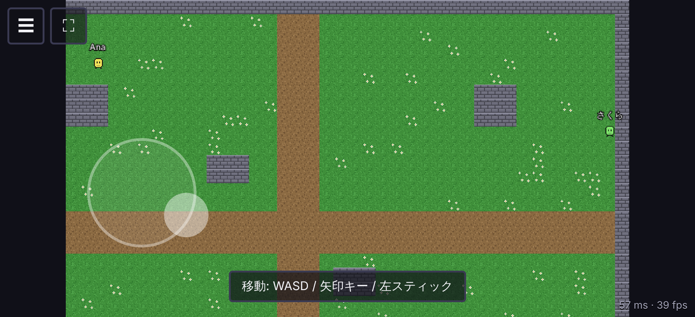
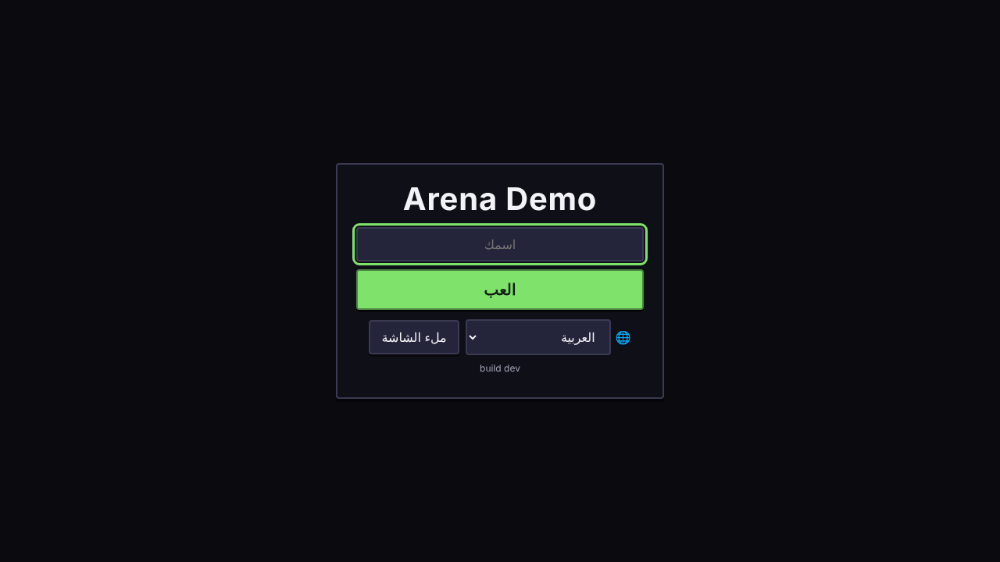

# Online Game Template

Base para jogos online web: começa como um jogo estilo `.io` e foi organizada para poder crescer até um multiplayer massivo.

**Stack:** Phaser 4 · TypeScript · Tiled · Pixel art (nearest-neighbor, zoom inteiro) · Colyseus 0.18 (servidor autoritativo) · Vite · pnpm · Biome · Vitest

> **Este repositório é um template.** Cada jogo novo é criado a partir dele e continua recebendo atualizações. Veja [`docs/TEMPLATE.md`](docs/TEMPLATE.md).
>
> Já vem pronto: servidor autoritativo com predição no cliente, reconexão, checagem de versão e área de interesse; GamePush (contas verificadas no servidor, anúncios, leaderboard); menus, configurações de som, chat, placar e lista de jogadores, telas de erro e resultado; sprites animados do Aseprite e áudio carregados automaticamente; 14 idiomas (com árabe RTL); teclado, controle e joystick de toque; mapas do Tiled; Docker, métricas e CI com testes ponta a ponta. O jogo de exemplo ("Arena Demo") só anda pelo mapa e ganha pontos andando.

| Celular (joystick, chat, placar) | Menu em árabe (RTL) |
|---|---|
|  |  |

## Requisitos

- [Node.js 22+](https://nodejs.org/)
- [pnpm](https://pnpm.io/) (`corepack enable` já ativa a versão certa)
- Opcional: [Tiled](https://www.mapeditor.org/) para editar mapas

## Testar no navegador, sem instalar nada (GitHub Codespaces)

1. No GitHub, abra o repositório e clique em **Code → Codespaces → Create codespace on main**.
2. Espere a instalação terminar (alguns minutos na primeira vez; o terminal mostra `pnpm install`).
3. No terminal, rode `pnpm dev`.
4. O jogo abre numa nova aba. Se não abrir, vá na aba **Ports** e clique no globo da porta **3000**.
5. Para testar multiplayer, abra o mesmo endereço em outra aba, ou no celular (logado no GitHub).

O Codespaces tem uma cota mensal gratuita. Quando terminar, pare o codespace em [github.com/codespaces](https://github.com/codespaces) para não gastar a cota.

## Rodando no seu computador

```bash
pnpm install
pnpm dev            # servidor (ws://localhost:2567) + cliente (http://localhost:3000)
```

Abra http://localhost:3000 em **duas ou mais abas** para ver os jogadores sincronizando. O nome é digitado no menu (ou `?name=Ana` na URL).

- **Simular internet ruim:** abra com `?debug` na URL para ver o painel de debug do Colyseus. No console do navegador, `__net(150, 30)` simula 150 ms de ping ± 30 ms de variação; `__net()` desliga. O botão **Drop** derruba a conexão para testar a reconexão.
- **Idioma:** `?lang=ar` (ou qualquer um dos 14) força o idioma; também dá para trocar no menu.
- **Testar no celular:** com o celular na mesma Wi-Fi, abra `http://<ip-do-seu-pc>:3000`. Em desenvolvimento o jogo fala com o servidor pela própria porta 3000, então não é preciso liberar outra porta.
- **Bots:** com o servidor rodando, `pnpm loadtest` coloca 20 jogadores falsos andando pelo mapa.
- **Monitor do servidor (dev):** http://localhost:2567/monitor

## Comandos

| Comando | O que faz |
|---|---|
| `pnpm dev` | Servidor + cliente em modo desenvolvimento |
| `pnpm test` | Testes unitários e de integração (Vitest) |
| `pnpm typecheck` | Checagem de tipos em todos os pacotes |
| `pnpm lint` / `pnpm lint:fix` | Revisão automática de código e formatação (Biome) |
| `pnpm content:validate` | Confere mapas, sprites e áudio |
| `pnpm assets:sprites` | Exporta os `.aseprite` de `content/sprites/src/` (precisa do Aseprite/LibreSprite) |
| `pnpm check` | Lint, tipos, testes e validação de conteúdo de uma vez. A CI roda isso, mais o build e o e2e |
| `pnpm build` | Build de produção do cliente (`apps/client/dist`) e do servidor (`apps/server/build`) |
| `pnpm pack:client` | Gera o `.zip` do cliente para GamePush/itch.io (depois do build) |
| `pnpm e2e` | Testes ponta a ponta com navegadores reais (Playwright) |
| `pnpm loadtest` | Bots para teste de carga |
| `pnpm assets:placeholder --force` | Volta a arte, os sons e o mapa provisórios (sobrescreve os arquivos em `content/`) |
| `pnpm init-game --name "Meu Jogo"` | Renomeia o projeto ao criar um jogo novo |

## Estrutura

```text
packages/core-*   NÚCLEO do template: servidor base, telas, idiomas, input, plataforma, mapas
game/*            O JOGO: regras (shared), salas (server), cenas e textos (client)
apps/*            Entradas finas que ligam núcleo + jogo
content/          Mapas (.tmj), tilesets, sprites
tools/            Arte provisória, validação de mapas, bots, init-game
docs/             Arquitetura, pesquisa, testes, uso do template, decisões
```

Detalhes em [`docs/ARCHITECTURE.md`](docs/ARCHITECTURE.md). Como criar mapas: [`content/README.md`](content/README.md).

## Configuração

Todas as variáveis de cliente e servidor (GamePush, origens permitidas, Redis, monitor...) estão em [`docs/DEPLOY.md`](docs/DEPLOY.md). Para desenvolver com o GamePush, crie `apps/client/.env.local` (não vai para o git):

```bash
VITE_PLATFORM=gamepush
VITE_GAMEPUSH_PROJECT_ID=<id do projeto>
VITE_GAMEPUSH_PUBLIC_TOKEN=<token público>
```

## Documentação

- [`docs/TEMPLATE.md`](docs/TEMPLATE.md): criar um jogo novo e receber atualizações do template
- [`docs/DEPLOY.md`](docs/DEPLOY.md): publicar servidor e cliente, variáveis de ambiente, GamePush, itch.io, release
- [`docs/ARCHITECTURE.md`](docs/ARCHITECTURE.md): princípios, estrutura, contrato núcleo ↔ jogo, escalabilidade
- [`docs/RESEARCH.md`](docs/RESEARCH.md): pesquisa sobre jogos online web, GamePush, hospedagem e decisões
- [`docs/TESTING.md`](docs/TESTING.md): estratégia de testes do multiplayer (sem precisar de vários jogadores)
- [`docs/adr/`](docs/adr/): registros de decisões de arquitetura
- [`CHANGELOG.md`](CHANGELOG.md): mudanças por versão do template
- [`CLAUDE.md`](CLAUDE.md): regras do projeto para agentes de IA
