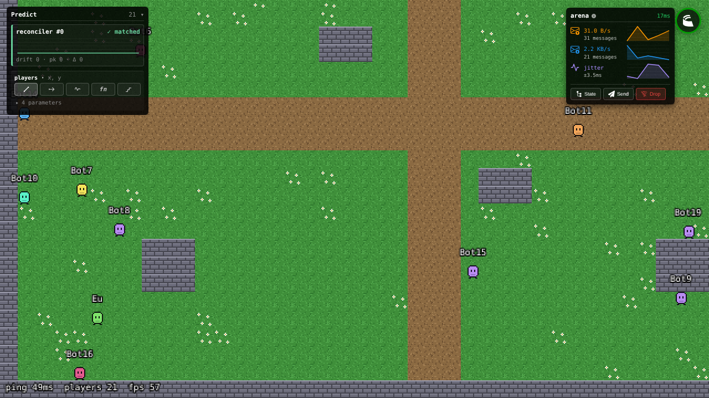

# Arquitetura

> O raciocínio por trás das escolhas está em [`RESEARCH.md`](./RESEARCH.md), e as decisões em [`adr/`](./adr/). Para criar jogos a partir daqui, veja [`TEMPLATE.md`](./TEMPLATE.md).



## 1. Princípios

1. **Núcleo separado do jogo.** O template mantém `packages/core-*`; cada jogo edita só `game/*` e `content/`. Assim os jogos recebem melhorias do template sem conflitos.
2. **Servidor autoritativo.** O cliente envia só *intenções* (inputs); o servidor decide o resultado. Nunca confiar no cliente.
3. **Simulação compartilhada e determinística.** As regras (ex.: `stepPlayer`) ficam em `game/shared`, em TypeScript puro, e rodam iguais no servidor e na predição do cliente.
4. **Contrato de rede versionado.** Cliente e servidor trocam `CORE_PROTOCOL_VERSION` e `PROTOCOL_VERSION`; se forem diferentes, o jogador vê "Nova versão disponível" e recarrega.
5. **Mapas Tiled como fonte única.** O cliente desenha e o servidor colide usando o mesmo `.tmj` de `content/maps`.
6. **Interface em DOM, jogo no canvas.** Menus e HUD são HTML/CSS sobre o Phaser: suportam todas as escritas, inclusive RTL, e ficam nítidos em qualquer zoom.
7. **Dispositivos e plataformas isolados.** O jogo lê `InputManager` (teclado, controle e toque) e `Platform` (GamePush ou web), nunca APIs específicas.
8. **Dependências apontam para dentro:** `apps` → `game` → `core`. O núcleo nunca importa o jogo.

## 2. Estrutura de pastas

```text
online-game-template/
├── packages/                         NÚCLEO (template). Não editar nos jogos.
│   ├── core-shared/   @core/shared   Colisão, SpatialHash, versões e códigos de erro, sanitizeName
│   ├── core-maps/     @core/maps     Leitura e validação de mapas Tiled (sem Phaser)
│   ├── core-server/   @core/server   GameRoom, contas (GamePush), InterestManager, createGameServer (env, logs, métricas, Redis, origens), loadMap
│   └── core-client/   @core/client   startClient: telas, i18n (14 idiomas), input, plataforma, rede
│       └── src/
│           ├── startClient.ts        Fluxo: carregando → menu → conectando → partida → resultado/erros
│           ├── GameModule.ts         Contrato entre núcleo e jogo (GameModule, GameContext)
│           ├── i18n/                 Idiomas, mensagens do núcleo, plurais, RTL
│           ├── input/                Teclado, gamepad, joystick e botões de toque
│           ├── ui/                   Telas DOM + CSS (variáveis --ui-* para tema)
│           ├── platform/             Platform, WebPlatform, GamePushPlatform
│           ├── net/session.ts        Entrada na sala, versões, erros, espera do 1º estado
│           └── scenes/BootScene.ts   Carregamento dos assets do jogo
│
├── game/                             JOGO. Edite à vontade nos repositórios derivados.
│   ├── shared/        @game/shared   PROTOCOL_VERSION, constantes, schemas, stepPlayer
│   ├── server/        @game/server   Salas (ArenaRoom) + testes
│   └── client/        @game/client   GameModule, cenas, render, assets, textos, bots
│
├── apps/                             Entradas finas (template)
│   ├── client/                       index.html + main.ts → startClient(game)
│   └── server/                       app.config.ts → createGameServer(rooms)
│
├── content/                          Mapas (.tmj), tilesets, sprites (do jogo)
├── tools/
│   ├── assets/                       Arte provisória, validação de mapas
│   ├── loadtest/                     Bots (comportamento em game/client/src/bot.ts)
│   ├── e2e/                          Testes ponta a ponta (Playwright)
│   ├── release/                      pnpm pack:client (.zip para GamePush/itch.io)
│   └── template/                     pnpm init-game
├── infra/docker-compose.yml          Servidor + Redis local
├── Dockerfile                        Imagem do servidor
├── docs/                             Arquitetura, pesquisa, testes, uso do template, ADRs
├── CLAUDE.md                         Regras do projeto para agentes de IA
├── CHANGELOG.md · TEMPLATE_VERSION   Versões do template
└── .github/workflows/                ci.yml (lint, tipos, mapas, testes, build, e2e) e release.yml
```

## 3. Contrato núcleo ↔ jogo

O jogo exporta um `GameModule` (`game/client/src/index.ts`) e salas que estendem `GameRoom` (`game/server`).

```ts
// cliente
export const game: GameModule<ArenaState> = {
  title, id, protocolVersion, roomName, rootSchema,
  resolution, orientation, preload, scenes, gameSceneKey,
  actions,   // ações extras: teclas, botão de gamepad e botão de toque
  messages,  // textos do jogo nos 14 idiomas
};

// a cena do jogo recebe o contexto em init(ctx: GameContext)
ctx.room       // sala Colyseus já conectada, com o primeiro estado recebido
ctx.input      // move {x,y} e isDown("acao")
ctx.t          // tradução
ctx.hud        // elemento DOM para widgets de HUD do jogo
ctx.audio      // playMusic("theme"), playSfx("join"): volumes do jogador já aplicados
ctx.ui         // toast(texto), setScores(linhas) → placar + lista (Tab); chat embutido
ctx.endMatch({ title, rows })   // tela de resultado
ctx.exitToMenu()
```

```ts
// servidor
class MinhaSala extends GameRoom<{ state: MeuEstado; input: MeuInput }> {
  protected readonly protocolVersion = PROTOCOL_VERSION;
  // onCreate / onJoin / onLeave / simulação; this.identity(client).name já vem sanitizado
}
```

## 4. Fluxo de dados em runtime

```text
Cliente (60+ fps)                                   Servidor (tick fixo de 30 Hz)
─────────────────                                   ─────────────────────────────
InputManager (teclado+gamepad+toque) → move {x,y}
GameScene: 1 input por tick (predict.tick)     ──► buffer de inputs por jogador (defineInput)
  reconciler aplica stepPlayer na hora                sanitize corta valores fora do intervalo
                                                       startSimulation → stepPlayer(...)
Estado (binário, delta) ◄────────────────────────── ArenaState { mapId, players }
  próprio jogador: rollback + replay se divergir
  outros: interpolação
```

Entrada na sala: o cliente envia `{ v: {core, game}, name, locale, auth? }`. O `GameRoom.onAuth` valida as versões, depois `authenticate()` define a identidade: conta verificada quando há `auth` e um provedor registrado (GamePush), ou convidado. O cliente só começa a partida depois que o primeiro estado completo chega.

Queda de conexão: o SDK tenta reconectar sozinho e a tela mostra "Reconectando…". O servidor guarda a vaga por 20 s. Se não voltar, aparece "Você foi desconectado".

## 5. Como estender (num jogo)

| Quero... | Onde mexer |
|---|---|
| Nova regra de jogo (dash, dano) | `game/shared` (pura, com testes) + aplicar em `ArenaRoom.step` |
| Novo campo sincronizado | `game/shared/src/net/schema.ts` + aumentar `PROTOCOL_VERSION` |
| Nova ação (botão) | `actions` no GameModule + `ctx.input.isDown("id")` + campo no input schema |
| Texto novo | `game/client/src/messages.ts` (14 idiomas; o teste acusa os que faltam) |
| Fim de partida | `ctx.endMatch({ title, rows })` na cena |
| HUD do jogo (placar) | Elementos DOM em `ctx.hud`, estilos em `game/client/src/styles.css` |
| Novo mapa | `content/maps` (e o tileset em `content/tilesets`); carregados sozinhos (ver `content/README.md`) |
| Sprite animado novo | `content/sprites/<nome>.png+json` (Aseprite) → `sprite.play(animKey("<nome>", "<tag>"))` |
| Som ou música nova | Arquivo em `content/audio/sfx` ou `content/audio/music` → `ctx.audio.playSfx("<nome>")` |
| Placar | `ctx.ui.setScores([{ id, name, score }], meuId)`; os dados vêm de um campo do estado que não passa pela área de interesse (veja `roster`) |
| Moderar o chat | Sobrescrever `filterChat(texto, client)` na sala (retorne `null` para descartar) |
| Tema visual da interface | Sobrescrever variáveis `--ui-*` em `game/client/src/styles.css` |
| Contas reais | Já funciona com GamePush (`GAMEPUSH_*` no servidor). Exigir conta: `allowGuests = false` na sala. Outro provedor: `registerAccountProvider` (ver ADR 0004) |
| Anúncio com recompensa | `if (await ctx.platform.ads.showRewarded()) { /* dar recompensa via mensagem ao servidor */ }` |
| Área de interesse para novas entidades | Coleção com `.view()` no schema + `InterestManager` na sala (ver `ArenaRoom`) |
| Métricas de um tick | `this.startSimulation(step, TICK_RATE)`; aparecem em `GET /metrics` |

## 6. Caminho de escalabilidade

| Etapa | Cenário | O que muda |
|---|---|---|
| 0 | Protótipo `.io` | 1 processo Node, várias salas em memória (**hoje**) |
| 1 | `.io` em produção | N processos com Redis (`@colyseus/redis-presence` + `redis-driver`), várias regiões |
| 2 | Muitas partidas simultâneas | Contêineres + orquestração (ex.: Agones), autoscaling |
| 3 | Mundo persistente / MMO | Zonas (cada zona = uma sala), handoff, AoI com `StateView`, persistência própria, serviços separados |

## 7. Produção

Deploy, variáveis de ambiente, GamePush, itch.io e release automático: [`DEPLOY.md`](./DEPLOY.md).

Na rede, o servidor tem:
- validação de versão e de conta em `onAuth`;
- limite de mensagens por segundo e de tamanho de mensagem;
- lista de origens permitidas (`ALLOWED_ORIGINS`);
- área de interesse, para que cada cliente receba só o que está perto.

Observabilidade: `/health`, `/version`, `/metrics` (Prometheus) e logs em JSON.

## 8. Próximos passos sugeridos

- Persistência própria (Postgres) quando um jogo precisar de dados de mundo.
- Zonas de MMO: troca de jogador entre salas e mundo contínuo.
